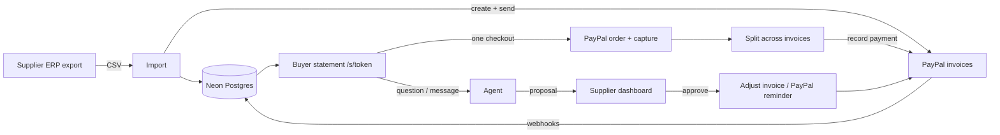
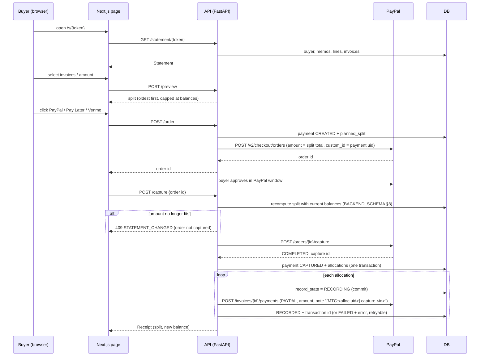
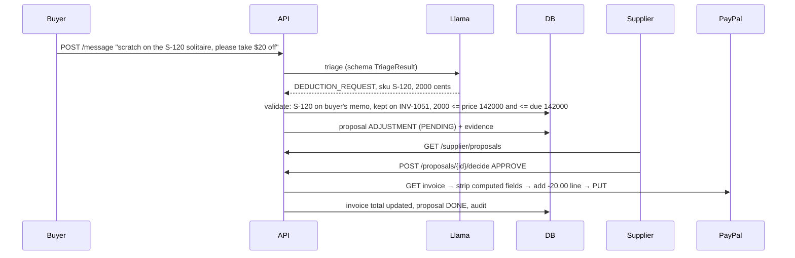

# Memo-to-Cash — App Flow

Who: **Supplier** (owner/accountant), **Buyer** (retailer), **Agent** (Llama, read + propose only), **PayPal**, **System** (our backend).

## 0. Big picture

## 1. Journey J1 — Judge (no login, < 3 min)
1. Opens `/` → sees one line of pain + three buttons.
2. "Start the demo" → `POST /demo/start` creates **their own** copy of Northside Jewelers (fresh PayPal sandbox invoices) → redirect to `/s/{token}`.
3. Expands memo M-201 → sees S-102 *Returned · R-311*, S-104 *Kept → INV-1038*, S-103 *Still with you*.
4. Asks "Why is S-102 on my bill?" → agent: "S-102 isn't billed — your return R-311 was received <date>. S-103 is still with you, due back <date>." (dates relative to demo start)
5. Pays $5,000 → PayPal popup → sandbox buyer (credentials shown on page) → receipt with split.
6. "See it as the supplier" → `/supplier` → payment row already split; opens PayPal invoice to confirm; approves the **seeded** proposal ("scratch on the S-120 solitaire, take $20 off" → −$20 on INV-1051 — every demo copy starts with this one pending message + proposal). The judge can also send their own message from the statement.
   - If a visitor clicks "See the supplier side" before starting a demo, `/demo/start` runs first.
7. "Start again" creates another fresh copy.

## 2. Journey J2 — Buyer pays several invoices at once

Edge cases: buyer closes PayPal window → payment stays CREATED, nothing recorded; capture fails → shown plainly, no allocations; one record call fails → receipt says "recorded 1 of 2, retrying", supplier sees retry button; double click / repeated `/capture` → if the payment is already `CAPTURED`, return the **existing receipt with 200** (no second capture, no second allocation). 409 is used only for `STATEMENT_CHANGED`. Buyer closes the tab after approving → the order is `APPROVED`; it's captured by the `CHECKOUT.ORDER.APPROVED` webhook or the sweep (TRD §6b-2).

## 3. Journey J3 — Buyer asks a question
1. `POST /ask {question}` → rate-limit check (llm_usage).
2. Agent gets system prompt + quoted question + read-only tools scoped to this buyer.
3. Model calls tools (e.g. `find_memo_line("S-102")`, `get_return_record("S-102")`), returns `AnswerResult`.
4. Validator: cited records exist and belong to buyer; every money figure is in the allowed set (record values ∪ code-computed totals, TRD §6).
5. Pass → show answer with record chips. Fail/timeout → "I'll ask Demo Diamond Co. for you" + proposal (kind REPLY).

## 4. Journey J4 — Buyer message → proposal → supplier decides

Other labels: RETURN_CLAIM → RETURN_CHECK proposal with evidence MATCH / NO_RECORD / ALREADY_CREDITED; PAYMENT_PROMISE → PROMISE_NOTE (shown on buyer row, pauses reminders until date); DISPUTE/OTHER → REPLY proposal for the supplier to answer.

## 5. Journey J5 — Supplier imports ERP export
1. Upload CSV → validate rows (report errors per row, nothing half-written per invoice).
2. Upsert buyers, memos, lines, returns, invoices.
3. For each invoice without `paypal_invoice_id`: create + send on PayPal (`PayPal-Request-Id` = `<env>-inv-<invoice uid>`) → store id + payer URL.
4. Summary: created / updated / errors.

## 6. Journey J6 — Buyer pays one invoice directly on PayPal's page
1. PayPal sends `INVOICING.INVOICE.PAID` → `/paypal/webhook`. (`PAYMENT.CAPTURE.COMPLETED` for a statement order → lost-capture recovery, TRD §6b-2.)
2. Verify signature → store event (unique id) → 200.
3. Process exactly per **TRD §6b**: if the invoice has an allocation in `RECORDING`, leave the event for the sweep; otherwise GET the invoice → list `payments.transactions` → a transaction is ours if it matches `allocations.paypal_transaction_id` **or** its note has the exact token `[MTC:<allocation uid>]` → only unmatched ones become new payments (source `PAYPAL_INVOICE_PAGE`) → update `paid_cents`, status.
4. Statement and supplier view reflect it on next load.

## 7. Journey J7 — Reminder
1. Once a day the background worker (09:00 America/New_York) → find invoices past due with no promise → agent drafts `ReminderDraft` → proposal REMINDER.
2. Supplier approves → check `reminders_sent` (< 2 today) → `POST /invoices/{id}/remind` → PayPal emails the buyer → audit.

## 7b. Journey J8 — Supplier records a cheque
1. Supplier opens buyer → "Record payment" → method (Cheque/Wire/Other), reference (cheque no.), amount, optional invoices.
2. `POST /supplier/payments/record` → same split rule → payment (source OFF_PAYPAL, status RECORDED) + allocations (one transaction).
3. Each allocation, exactly like statement payments (invariant 9): `record_state = RECORDING` (commit) → `POST /invoices/{id}/payments` with `method: CHECK` (or WIRE_TRANSFER/OTHER) and note `[MTC:<allocation uid>] cheque 1043` → RECORDED + transaction id, or FAILED (retryable by the sweep).
4. Statement `payments` list shows it: "Cheque #1043 · $2,000 · applied to INV-1038".

## 7c. Journey J9 — Getting the link to the buyer
1. Each mirrored PayPal invoice carries the statement link in its note (visible on PayPal's invoice page and email).
2. Supplier dashboard → buyer row → "Copy statement link" to paste into their usual email/WhatsApp.

## 8. State machines
- **Memo line:** OUT → RETURNED (return record) | OUT → KEPT (on an invoice). Never both.
- **Invoice (ours, `ledger_status`):** DRAFT → OPEN → PARTIALLY_PAID → PAID; any → CANCELLED. Derived from allocations. **PayPal's status** is stored raw in `paypal_status` (UNPAID, PARTIALLY_PAID, MARKED_AS_PAID, PAID, PAYMENT_PENDING, …); if PayPal's due ≠ ours, `mismatch` is set and shown to the supplier.
- **Payment:** see `BACKEND_SCHEMA.md §8` (STATEMENT: CREATED → CAPTURED | FAILED | VOIDED · OFF_PAYPAL: RECORDED · PAYPAL_INVOICE_PAGE: CAPTURED · → REFUNDED shown only).
- **Allocation (record_state):** PENDING → RECORDING → RECORDED | FAILED (retryable, attempts++).
- **Proposal:** PENDING → APPROVED → DONE | FAILED; PENDING → REJECTED.
